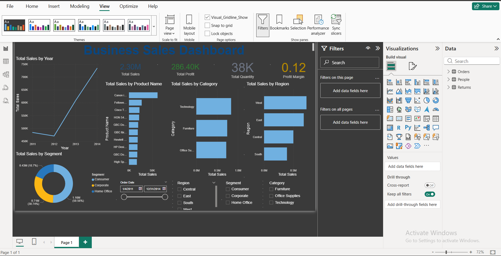

# FUTURE_DS_01 – Business Sales Dashboard (Power BI)

## Project Overview

This project presents an interactive business sales dashboard developed using Power BI to analyse e-commerce sales data and generate insights that support business decision-making.

## Business Objectives

- Track key sales and revenue metrics.
- Identify top-performing products and categories.
- Analyse sales trends over time.
- Compare regional business performance.
- Support data-driven business decisions.

## Tools & Technologies

- Power BI Desktop
- Power Query
- DAX
- Microsoft Excel
- CSV datasets

## Technical Implementation

### 1. Data Preparation

- Imported source datasets into Power BI.
- Used Power Query to inspect, clean and transform the data.
- Prepared datasets for analysis and reporting.

### 2. Data Modelling

Developed a relational data model comprising three tables:

- **Orders:** Contains order and sales information.
- **People:** Contains personnel and regional information.
- **Returns:** Contains order return information.

Established one-to-many relationships between the Orders table and the People and Returns tables to support connected analysis across the dashboard.

### 3. DAX Measures

Created calculated measures using DAX to support business performance analysis.

DAX functions used included:

- `SUM()` – numerical aggregation.
- `CALCULATE()` – evaluation of expressions under modified filter contexts.
- `DIVIDE()` – division with protection against division-by-zero errors.
- `COUNTROWS()` – counting table records.
- `AVERAGE()` – calculating average values.
- `DISTINCTCOUNT()` – counting unique values.

### 4. Dashboard Development

Developed dashboard visuals to communicate key business performance indicators, including:

- Sales and revenue performance.
- Product and category performance.
- Sales trends over time.
- Regional performance.
- Business insights for decision-making.

## Dashboard Preview



## Key Business Insights

- A small number of products contribute the majority of revenue.
- Sales demonstrate seasonal trends.
- Certain regions consistently outperform others.

## Business Recommendations

- Prioritise marketing for high-performing categories.
- Align inventory planning with peak sales periods.
- Explore growth opportunities in underperforming regions.

## Repository Structure

```text
FUTURE_DS_01/
│
├── data/
│   └── Source datasets
│
├── powerbi/
│   └── Business_Sales_Dashboard.pbix
│
├── reports/
│   └── Business insights report
│
├── visuals/
│   └── dashboard_overview.png
│
└── README.md
```

## Author

**Stephen Otieno**

GitHub: https://github.com/salimstephen
